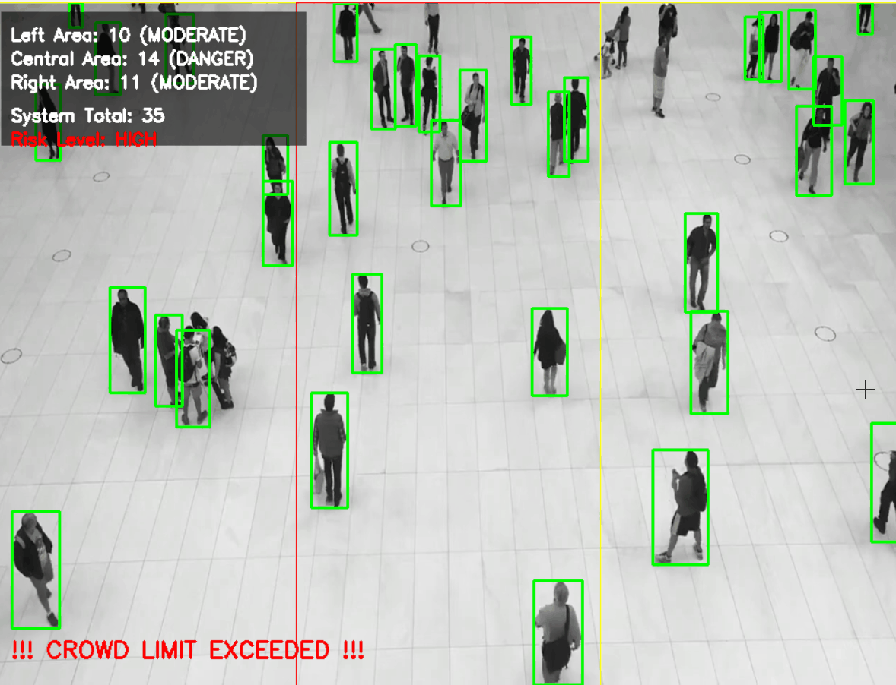
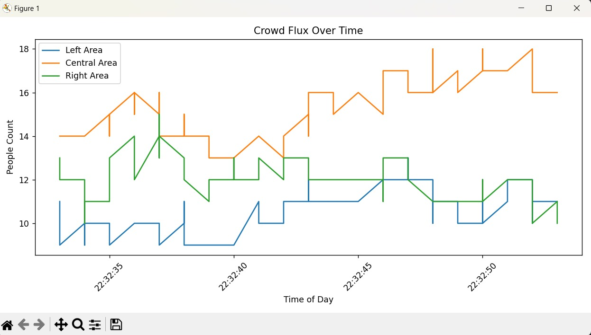
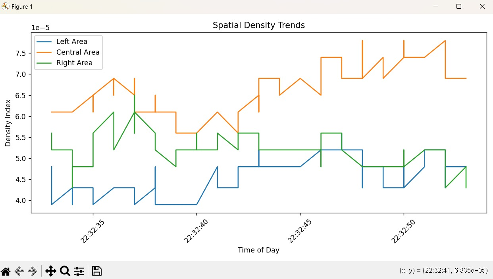
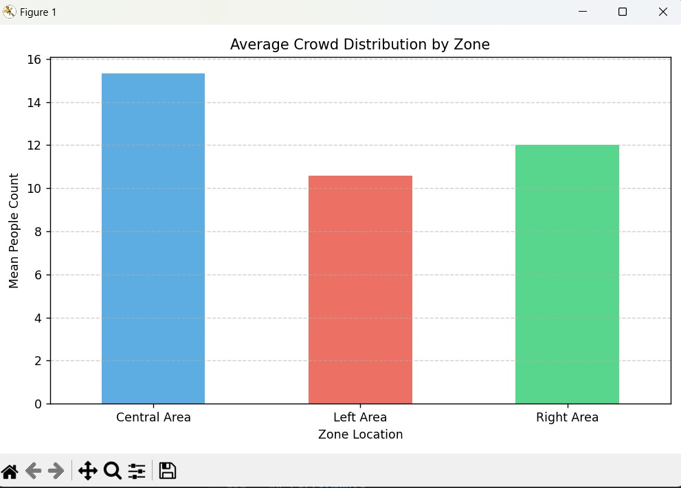

# SentinelFlow: Real-Time Crowd Density Monitoring & Analytics System



## Overview

SentinelFlow is a project I built to monitor and analyze crowd density using computer vision and data analytics. The idea was to go beyond just detecting people in a frame and actually make sense of how crowds behave over time.

The system takes in a live webcam feed or a recorded video, detects people using YOLOv8, divides the frame into zones, and estimates crowd density in each zone. It then logs this data and generates insights like trends, peak congestion, and overall risk levels.

---

## What it does

* Detects people in real time (~20–30 FPS)
* Splits the frame into zones (Left, Center, Right)
* Calculates crowd density per zone
* Classifies zones as SAFE, MODERATE, or DANGER
* Raises alerts when overcrowding is detected
* Logs data into a CSV file for analysis
* Generates graphs and summary reports
* Includes both rule-based and optional LLM-based reporting

---

## How it works

### Detection

I opted for YOLOv8s over the Nano variant. Through testing, I found the 'Small' model offered a significant accuracy boost in crowded scenes without sacrificing the real-time 20+ FPS requirement.

The confidence threshold is set around 0.2 to make sure fewer people are missed, even if it slightly increases false positives.

---

### Zones

The frame is divided into three regions:

* Left
* Center
* Right

Each detected person is assigned to a zone based on the center of their bounding box.

---

### Density calculation

Density is calculated as:

```
Density = Number of People / Zone Area
```

This helps normalize the count across zones of different sizes.

---

### Risk classification

Each zone is classified based on density:

* SAFE
* MODERATE
* DANGER

Initially, I used a simple global approach to calculate risk, but it didn’t work well when only specific zones were overcrowded.

So I improved it by computing a risk score for each zone:

```
danger_ratio = danger_frames / total_frames
```

Then I combine the results like this:

* If any zone has high risk → overall risk = HIGH
* Else if average risk is moderate → overall risk = MODERATE
* Else → LOW

This way, even if one area is overcrowded, it doesn’t get ignored.

---

## Data logging

The system stores data in a CSV file with the following fields:

```
Time, Zone, Count, Density, Status
```

This creates a time-series dataset that can be analyzed later.

---

## Analysis and reporting

I built a separate analysis script using Pandas and Matplotlib.

It generates:

* People count vs time
* Density vs time
* Zone-wise comparisons
* Peak congestion detection

It also creates a text report that includes:

* Trend (increasing or stable)
* High-density zones
* Peak time
* Overall risk level

There’s also an optional LLM-based report generator, but it falls back to the rule-based version if the API isn’t available.

I built a separate analysis script using Pandas and Matplotlib to transform raw CSV logs into actionable insights:

 Temporal Count Trends:  
  

 Density Analysis:
 
 
 Spatial Distribution:
  
 

---

## Performance

* Runs at around 20–30 FPS on CPU
* Detects roughly 15–20 people per frame (depending on video)
* Works best in well-lit, medium-density scenarios

---

## Challenges I faced

* Detection drops when people overlap heavily (occlusion)
* Low lighting affects accuracy
* Fast motion can reduce detection stability
* Density thresholds are manually tuned, not mapped to real-world units

---

## Design choices

* Used YOLOv8s instead of yolov8n for better accuracy
* Lowered confidence threshold to improve recall
* Used zone-based analysis instead of global counting
* Added temporal risk (danger_ratio) instead of single-frame decisions

---

## Tech stack

* Python
* OpenCV
* YOLOv8 
* Pandas
* Matplotlib
* OpenAI API 
* Streamlit 

---

## Project structure

```
crowd-detection/
│
├── main.py          # detection + logging
├── analyze.py       # analysis + reporting
├── crowd_data.csv   # generated data
├── README.md
```

---

## How to run

Install dependencies:

```
pip install opencv-python-headless ultralytics pandas matplotlib python-dotenv openai streamlit
```

Run the interactive dashboard:

```
python -m streamlit run app.py
```

Run detection:

```
python main.py
```

Run analysis:

```
python analyze.py
```

---

## Applications

* Crowd monitoring in public spaces
* Event and stadium management
* Railway stations and transport hubs
* Smart surveillance systems

---

## Future improvements

* Add object tracking (DeepSORT / ByteTrack)
* Calibrate density to real-world units (people per m²)
* Add real-time alerts (SMS, notifications)
* Use ML models for anomaly detection
* Deploy on edge devices

---

## Final note

The goal of this project was to move beyond simple object detection and build something that actually provides useful insights. Instead of just counting people, it tries to understand crowd behavior over time and flag risky situations.

It’s still a work in progress, but it gave me a solid understanding of combining computer vision with data analysis and basic decision logic.
